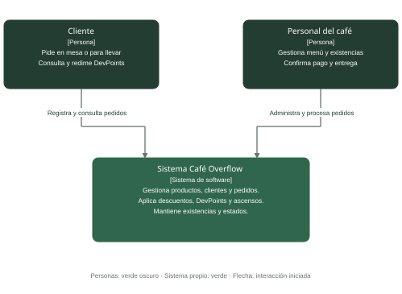
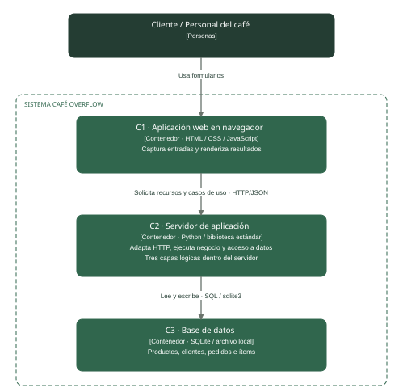
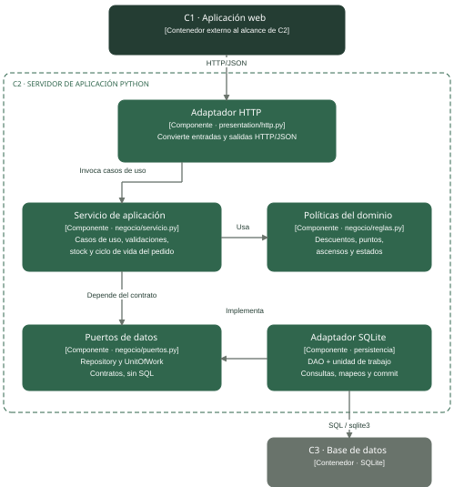

# Café Overflow · Taller Modelo N-Tier

DEV & COFFEE LOUNGE · DISEÑO E IMPLEMENTACIÓN

Universidad Autónoma de Bucaramanga · Arquitectura de Software
Docente: MSc. Feisar Moreno
3 de noviembre de 2026

## 1. Solución entregada

Aplicación web funcional desarrollada directamente con HTML, CSS, JavaScript, Python y SQLite, sin frameworks. Permite registrar clientes, gestionar productos, cotizar y registrar pedidos en mesa o para llevar, avanzar su estado y administrar el programa de lealtad con descuentos y DevPoints.

El código está separado en presentation, negocio y persistencia. La presentación no calcula descuentos ni consulta la base; el núcleo no conoce HTML, JSON ni SQL; el adaptador de datos no decide reglas de negocio. Un archivo de arranque conecta las implementaciones mediante contratos.

| Entregable | Contenido |
| --- | --- |
| Aplicación y código | Carpeta CafeOverflow con ejecutor, tres capas, interfaz web adaptable y base autogenerada. |
| Modelo C4 | Contexto, contenedores y componentes, incluidos en este documento y como archivos SVG editables. |
| Verificación | 39 pruebas automáticas aprobadas y recorrido manual en navegador. |
| Guía de uso | README con instalación, ejecución, reglas, API, estructura y demostración. |
| Repositorio público | Repositorio público: github.com/Calvarado187/cafe-overflow-n-tier. Incluye código, pruebas y documentación. |

## Alcance y actores

Cliente: crea su perfil, elige productos, solicita cotización, redime puntos y consulta pedidos. Personal del café: administra productos y stock, confirma el pago simulado, prepara y entrega pedidos. Estos son roles del caso; la demostración local no implementa autenticación ni permisos separados.

Los datos del catálogo son ejemplos. La aplicación escucha exclusivamente en la dirección local 127.0.0.1. No procesa cobros reales ni pretende ser una plataforma de comercio lista para exposición pública.

# 2. Reglas y decisiones explícitas

| Regla del enunciado | Implementación |
| --- | --- |
| Descuentos | Junior: 5 %. Mid: 10 %. Senior: 15 % sobre la suma de precio por cantidad. |
| Alta de cliente | Nivel Junior, monto acumulado $0 y saldo inicial 0 DevPoints. |
| Ascenso automático | Mid al alcanzar $500.000; Senior al alcanzar $1.500.000 en compras completadas. El límite es inclusivo. |
| Puntos ganados | 1 DevPoint por cada $20.000 netos consumidos en un pedido completado. |
| Puntos redimidos | Cada punto descontado del saldo representa $200 de rebaja directa en un pedido posterior. |
| Stock y pendiente | Se rechaza cantidad superior al stock y cualquier nuevo pedido si el cliente ya tiene uno pendiente de pago. |
| Ciclo del pedido | Pendiente de pago → En Preparación → Listo → Entregado. No se permiten saltos ni retrocesos. |

## Aspectos que el taller no define y cómo se resuelven

Completado: se interpreta como Entregado. Base del acumulado: total neto después de descuentos. Orden: primero porcentaje por nivel y luego redención. Puntos: se redondean hacia abajo por pedido, sin arrastrar fracciones entre compras. Exceso de redención: se rechaza; no se permite total negativo. Moneda: COP como supuesto de demostración, almacenada en centavos enteros. El descuento porcentual se redondea a un centavo con half-up.

Reserva: stock y puntos redimidos se descuentan al registrar el pedido; los puntos nuevos, el acumulado y el ascenso se aplican solo al entregarlo. Precios: cada pedido conserva una copia del precio y nivel usados al registrarse. Pago: confirmación manual simulada. No se incorporan estados de cancelación ni devolución porque el enunciado enumera cuatro estados; tampoco hay expiración automática de pendientes.

## Ejemplo comprobable

Un Junior compra dos combos de $24.000: subtotal $48.000; descuento de nivel $2.400; total $45.600. Si redime 3 puntos ya disponibles, recibe otros $600 de rebaja y paga $45.000. Al entregarse, suma $45.000 al histórico y gana 2 DevPoints. Si su histórico previo era $455.000, alcanza $500.000 y asciende a Mid. El pedido se conserva con 5 %; un nuevo pedido posterior obtiene 10 %.

# 3. Separación y aislamiento de capas

| Capa | Responsabilidad / archivos / límites |
| --- | --- |
| Presentación | presentation/http.py y presentation/static/: entrega vistas, captura formularios, transforma JSON y muestra resultados. Solo invoca servicios de negocio. No contiene porcentajes de descuento, umbrales de ascenso ni consultas SQL. |
| Negocio / aplicación | negocio/modelos.py, reglas.py, servicio.py y puertos.py: entidades, cálculos, validaciones, estados y coordinación transaccional por contrato. No importa presentation, persistencia, json, sqlite3 ni http. |
| Persistencia / datos | persistencia/sqlite.py: esquema, consultas parametrizadas, mapeo de entidades y transacciones. Guarda valores decididos por el núcleo. No importa las políticas ni el servicio y no evalúa descuentos, saldo suficiente o ascensos. |

## Flujo de ejecución

La interfaz envía una solicitud HTTP al adaptador. Este construye un objeto OrderRequest e invoca CafeService. El servicio consulta entidades a través de Repository, aplica las reglas y solicita guardar los cambios. SQLiteUnitOfWork confirma todas las escrituras juntas o las revierte si ocurre un error. El resultado retorna como objetos Python; solo el adaptador de presentación lo convierte a JSON.

## Dependencias de código y principio de inversión

La presentación depende del negocio. La persistencia utiliza los modelos del negocio e implementa sus contratos mediante tipado estructural. El negocio depende de abstracciones propias, no de SQLite. run.py es la raíz de composición: crea el adaptador y lo inyecta en el servicio, y luego inyecta el servicio en el servidor HTTP. Esto evita que una capa tenga que construir o importar directamente la tecnología de otra.

## Tres capas lógicas no equivalen a tres servidores

El requisito exige división lógica. En esta implementación, el navegador ejecuta la interfaz; un proceso Python ejecuta el adaptador HTTP, el negocio y el acceso a datos; SQLite utiliza un archivo local sin servidor propio. Se conservan tres capas de responsabilidad, aunque no se distribuyen en tres máquinas. Los contenedores C4 reflejan aplicaciones y datos, no carpetas ni capas. [1]

## Aislamiento verificable

Una prueba analiza importaciones para detectar dependencias prohibidas. Las pruebas de reglas usan funciones puras sin servidor ni base de datos. Las pruebas HTTP comprueban que un total y un nivel manipulados por el cliente no alteran el cálculo real. Convertir centavos a texto monetario en la UI es presentación de datos, no cálculo del precio del pedido.

# 4. C4 nivel 1 · Contexto

Vista del sistema como una unidad y de las personas que interactúan con él. No hay pasarela de pagos, proveedor de identidad ni otros sistemas externos integrados en el ejercicio. [2]

## Relaciones

Cliente → Café Overflow: registra perfil, consulta menú, solicita pedidos y redime DevPoints. Personal → Café Overflow: actualiza el menú, administra existencias y cambia estados. La respuesta del sistema está implícita en cada interacción.

## Límite del sistema

El sistema engloba la interfaz web, la aplicación Python y sus datos. GitHub aloja el código de entrega, pero no participa en el flujo operativo de los pedidos. El pago simulado no constituye una integración financiera. Los dos actores comparten la aplicación local para facilitar la evaluación del taller.

# 5. C4 nivel 2 · Contenedores

Descomposición del sistema en aplicaciones ejecutables y almacén de datos. La comunicación HTTP indicada corresponde al entorno local de demostración. [1]

C1: interfaz en el navegador, sin reglas monetarias. C2: servicio Python que publica archivos y operaciones JSON con http.server. C3: archivo SQLite al que únicamente accede el adaptador de persistencia. El navegador no conoce su ruta ni abre la base directamente.

El contorno discontinuo delimita Café Overflow; las personas están fuera. Las flechas indican el iniciador de la llamada. C2 también entrega los recursos HTML/CSS/JS como respuesta a C1; no se representa una segunda aplicación web de servidor independiente.

# 6. C4 nivel 3 · Componentes

Ampliación exclusiva del contenedor C2. C1 y C3 aparecen como contenedores de apoyo fuera de su límite. Los componentes se corresponden con archivos reales del proyecto. [3]

Flechas internas: invocación o dependencia, según la etiqueta. “Implementa” va del adaptador al contrato y no es una llamada de red. En ejecución, el servicio recibe una unidad de trabajo SQLite por inyección y llama a sus métodos a través de esos contratos.

Los modelos compartidos de negocio/modelos.py son objetos de dominio y transferencia, no un servicio independiente. run.py configura las dependencias al arrancar; no contiene reglas ni procesamiento de pedidos.

# 7. Persistencia e integridad

## Modelo de datos

| Tabla | Campos y relaciones principales |
| --- | --- |
| products | id, name, price_cents, stock. Identifica el producto y su disponibilidad actual. |
| clients | id, name, email único, level, points, accumulated_cents. Un cliente tiene muchos pedidos. |
| orders | id, client_id, state, created_at, importes, nivel aplicado, puntos ganables/redimidos, modalidad, mesa, request_key y completed_at. |
| order_lines | order_id, product_id, name, quantity, unit_price_cents y subtotal_cents. Clave compuesta por pedido y producto; conserva los datos de la compra. |

Relaciones: Cliente 1:N Pedido; Pedido 1:N Ítem; Producto 1:N Ítem. Las claves foráneas se habilitan en cada conexión. El total, descuento y precio del ítem son instantáneas calculadas por negocio, por lo que modificar el catálogo no reescribe el histórico.

## Pedidos simultáneos

SQLiteUnitOfWork ejecuta BEGIN IMMEDIATE antes de las lecturas. Esto serializa las escrituras: una segunda solicitud espera y después ve el stock, los puntos y los pedidos pendientes ya actualizados. El servicio valida todos los ítems y agrupa productos repetidos antes de guardar. Si falla una validación o una escritura, la transacción se revierte. Es una solución adecuada para esta demostración; el bloqueo global limita la capacidad ante carga elevada.

## Reintentos y acreditación única

La clave request_key junto con el cliente identifica un registro de pedido. Un reintento igual obtiene el pedido existente; un contenido diferente con la misma clave se rechaza. La transición repetida al estado actual no genera efectos adicionales. Al entregar, estado, puntos y acumulado se confirman juntos; se evita acreditar dos veces aun si dos solicitudes llegan a la vez.

## Responsabilidades del adaptador

El DAO usa parámetros SQL, mapea filas a entidades y persiste valores. Las restricciones de clave primaria, referencia y unicidad mantienen estructura; el DAO no decide si alcanza el saldo, si hay stock suficiente o qué nivel corresponde. Estas decisiones permanecen en CafeService y reglas.py.

## Límites de la demostración

No hay vencimiento automático, cancelación ni reversos. El stock de un pedido pendiente permanece reservado hasta que se atiende. No se incluyen usuarios autenticados: la separación visual de pantallas no constituye autorización. El servidor solo acepta acceso local y valida Host/Origin como protección básica, no como sustituto de autenticación.

# 8. Código y trazabilidad

| Requisito | Ubicación verificable |
| --- | --- |
| Nuevo cliente Junior | negocio/modelos.py: valores iniciales de Client; servicio.py: register_client. |
| 5 %, 10 % y 15 % | negocio/reglas.py: DISCOUNTS y calculate. |
| Ascensos $500.000 / $1.500.000 | negocio/reglas.py: level_for; servicio.py: change_state al entregar. |
| DevPoints ganados y redimidos | reglas.py: POINT_VALUE, POINT_SPEND, calculate; servicio.py: create_order y change_state. |
| Stock suficiente y líneas repetidas | servicio.py: _quote consolida cantidades y valida contra el producto persistido. |
| Un solo pedido pendiente | servicio.py: _quote revisa los pedidos del cliente dentro de la unidad de trabajo. |
| Estados válidos | reglas.py: STATES/next_state; servicio.py: change_state. |
| UI sin reglas monetarias | presentation/static/app.js solicita /api/quote y renderiza la respuesta. |
| Núcleo sin HTML/JSON/SQL | negocio contiene modelos, contratos, funciones puras y casos de uso. |
| Datos sin decisiones de negocio | persistencia/sqlite.py solo consulta, guarda, mapea y controla transacciones. |
| Aplicación sin frameworks | run.py y biblioteca estándar; ningún paquete requiere instalación por pip o npm. |

## Operaciones HTTP

GET /api/bootstrap: estado de la demostración. POST /api/clients: registrar cliente. POST /api/products y /api/products/{id}: crear/actualizar producto. POST /api/quote: cotizar sin efectos. POST /api/orders: registrar. POST /api/orders/{id}/state: avanzar estado.

Los importes de la API se expresan en centavos enteros. El cuerpo del pedido incluye client_id, items con product_id y quantity, redeem_points, mode, table y request_key. Los campos de total o nivel enviados por el navegador no se consideran confiables y no se utilizan para decidir el precio.

## Organización de entrega

El ZIP contiene CafeOverflow/ con todo el código, tests/, docs/, README, iniciar.bat y un flujo de pruebas para GitHub Actions. No incluye la base utilizada en la revisión ni datos personales. El directorio data/ se crea al ejecutar y está excluido de Git.

# 9. Ejecutar y demostrar

## Inicio en tres pasos

1. Instalar Python 3.10 o posterior. 2. Descomprimir el ZIP y abrir una terminal dentro de CafeOverflow. 3. Ejecutar python run.py y abrir http://127.0.0.1:8080. En Windows se incluye iniciar.bat. No hace falta instalar frameworks, librerías externas ni un servidor de base de datos.

## Recorrido de evaluación

| Paso | Acción y resultado esperado |
| --- | --- |
| 1 | Crear un perfil de prueba: aparece como Junior, con 0 puntos y $0 acumulados. |
| 2 | Agregar un Combo BugHunter de $24.000: el servidor devuelve $22.800 para Junior. |
| 3 | Elegir Mesa e indicar número, o Para llevar. Confirmar: nace un pedido Pendiente de pago y disminuye el stock. |
| 4 | Intentar un segundo pedido sin pagar: se muestra el rechazo de negocio. |
| 5 | En Cocina y caja: confirmar pago, marcar Listo y después Entregado. |
| 6 | Regresar al perfil: $22.800 acumulados y 1 DevPoint. |
| 7 | Agregar otro combo y redimir 1 punto: total $22.600. Los nuevos puntos se acreditan al entregar. |
| 8 | En Gestionar menú: crear/editar un producto y comprobar el catálogo. Un cambio no modifica pedidos históricos. |

## Pantallas

Pedir algo rico: catálogo, alta/selección de perfil, carrito, modalidad, cotización y pedidos propios. Cocina y caja: pedidos y siguiente transición permitida, indicada por negocio. Gestionar menú: nombre, precio y existencias. La vista se adapta a pantallas pequeñas y usa etiquetas y controles de formulario accesibles.

## Pruebas y reinicio de demostración

Ejecutar python -m unittest discover -s tests -v. La suite utiliza bases temporales. Para una demostración nueva sin borrar datos, usar python run.py --db data/otra-demo.sqlite3. Si el puerto está ocupado, añadir --port 8081. Detener con Ctrl+C.

Los ascensos se comprueban automáticamente con acumulados justo antes y en cada umbral, sin obligar a hacer decenas de pedidos manuales. Los ajustes de datos que utilizan esos casos de prueba no están expuestos en la interfaz.

# 10. Verificación realizada

Resultado: 39 pruebas automáticas aprobadas, ejecutadas sobre el código entregado. Se incluyen pruebas de políticas puras, aplicación con SQLite, concurrencia, API HTTP y aislamiento de capas. La evidencia de ejecución está en docs/PRUEBAS.txt.

| Grupo | Cobertura |
| --- | --- |
| Descuentos y puntos | Porcentajes de los tres niveles, redondeo half-up, división entera, aplicación después del descuento, saldo insuficiente y total no negativo. |
| Ascensos | Valores inmediatamente inferiores y exactamente iguales a ambos umbrales. El pedido previo conserva el descuento anterior. |
| Registro de pedidos | Stock, cantidades inválidas, ítems repetidos, productos inexistentes, carrito vacío, mesa y pedido pendiente. |
| Consistencia | Reserva al registrar, cotización sin efectos, rollback, reintento de creación y clave repetida con contenido distinto. |
| Estados y lealtad | Secuencia completa, rechazo de saltos y retrocesos, acreditación única y redención en siguiente compra. |
| Concurrencia | Dos clientes por la última unidad, dos pedidos pendientes del mismo cliente y dos entregas simultáneas. |
| Interfaz HTTP | Recorrido completo, total/nivel manipulados ignorados, recursos estáticos, rutas no permitidas, JSON inválido y origen ajeno. |
| Arquitectura | Análisis de importaciones para impedir dependencias entre capas no autorizadas. |

## Revisión de la interfaz en navegador

Se registró un cliente ficticio, se cotizó y creó un combo, se avanzó por los cuatro estados y se verificaron $22.800 acumulados y 1 punto. También se creó un producto desde Gestión de menú. Se revisó una vista de teléfono de 390 píxeles sin desbordamiento horizontal. Las capturas en docs/ corresponden a datos de prueba.

## Qué no demuestran estas pruebas

La revisión confirma las reglas del taller en los casos cubiertos. No equivale a certificación de seguridad, prueba de carga productiva ni integración con pagos reales. El flujo de GitHub Actions está preparado; su resultado remoto solo puede conocerse después de publicar el repositorio.

## Adecuación tecnológica

La biblioteca estándar evita dependencias y satisface la restricción de no usar frameworks. SQLite simplifica la ejecución para el docente; las interfaces permiten sustituir la persistencia conservando las reglas. Para alta concurrencia o acceso público, se requeriría revisar servidor, autenticación y almacenamiento. [4, 5]

# 11. Entrega y referencias

## Repositorio público solicitado por el taller

Repositorio de entrega: [Calvarado187/cafe-overflow-n-tier](https://github.com/Calvarado187/cafe-overflow-n-tier). Contiene README, código, pruebas y documentación. El archivo .gitignore excluye data/ y archivos SQLite para evitar subir información de ejecución. El proyecto incluye una automatización que ejecuta las pruebas en GitHub Actions con Python 3.12.

Entrega pública: el repositorio permite consultar y descargar el código y los diagramas del taller. La evidencia local está en docs/PRUEBAS.txt; el resultado de cada ejecución remota puede consultarse en la pestaña Actions del repositorio. GitHub Pages no ejecuta este servidor Python; el repositorio sirve como entrega del código, no como alojamiento automático de la aplicación.

## Fuentes

Fuente del caso: Universidad Autónoma de Bucaramanga, “12 - Taller Modelo N-Tier”, documento de tres páginas proporcionado para el ejercicio. Docente: MSc. Feisar Moreno. Las decisiones adicionales se identifican en la sección 2.

[1] Simon Brown · C4: Container
[https://c4model.com/abstractions/container](https://c4model.com/abstractions/container)

[2] Simon Brown · C4: System context diagram
[https://c4model.com/diagrams/system-context](https://c4model.com/diagrams/system-context)

[3] Simon Brown · C4: Component diagram
[https://c4model.com/diagrams/component](https://c4model.com/diagrams/component)

[4] Python · http.server
[https://docs.python.org/3/library/http.server.html](https://docs.python.org/3/library/http.server.html)

[5] Python · sqlite3
[https://docs.python.org/3/library/sqlite3.html](https://docs.python.org/3/library/sqlite3.html)

[6] Python · unittest
[https://docs.python.org/3/library/unittest.html](https://docs.python.org/3/library/unittest.html)

Consultadas el 3 de noviembre de 2026. La documentación oficial de http.server advierte que no está recomendado para producción; por ello la implementación se entrega como aplicación académica local. [4]
